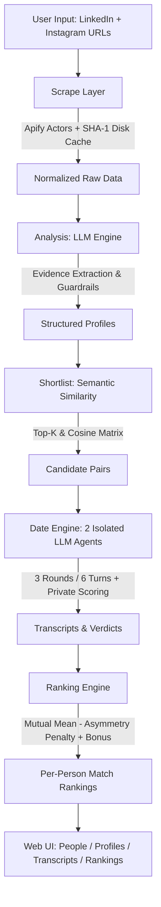

# 💘 Agent Dating

> Each person gets an AI agent that reads their LinkedIn and public Instagram, builds a profile, then dates other agents on their behalf. The dates produce a ranked list of best matches for everyone.

[](LICENSE)
[](https://fastapi.tiangolo.com)
[](https://www.python.org/downloads/)

---

## 🌐 Live Demo & Deployment

- **Live Application:** `https://agent-dating.onrender.com` *(placeholder)*
- **Demo Mode:** Load 26 pre-computed profiles and 50 multi-turn dates with a single click—no API keys required.

---

## 🏗️ Architecture



---

## ⚙️ Technical Highlights

- **Scraping Layer:** Apify actors scrape public Instagram (`apify/instagram-profile-scraper`) and LinkedIn profiles (`harvestapi/linkedin-profile-scraper`) with zero logged-in sessions or cookies. Scrapes are disk-cached by `sha1(normalized_url)` to guarantee zero redundant network calls.
- **Analysis Engine:** Open-weight LLMs (`openai/gpt-oss-120b` on Groq, failing over to Google AI Studio Gemini Flash) extract structured profiles with strict evidence grounding. Every claim in needs, hobbies, interests, values, and dealbreakers includes direct quotations from posts or headlines.
- **Pair Shortlisting:** Semantic embedding cosine similarity (`sentence-transformers/all-MiniLM-L6-v2` with scikit-learn TF-IDF fallback) shortlists the top candidate pairs, capped by safety thresholds (`MAX_PAIRS=50`).
- **Date Simulation:** Two distinct, isolated LLM streams (`openai/gpt-oss-20b`) converse across 3 rounds (6 turns). Neither agent ever sees the other's profile—only conversational turns. After the date, each agent executes a private evaluation call.
- **Ranking Formula:** Calibrated match scores combine mutual mean, an asymmetry penalty, and mutual interest bonus:
  $$\text{final} = \text{clamp}\left(\frac{\text{score}_A + \text{score}_B}{2} - 0.3 \times |\text{score}_A - \text{score}_B| + \text{bonus}, 0, 100\right)$$
  Non-dated pairs fallback gracefully to scaled embedding similarity.
- **Async Web Architecture:** FastAPI backend with non-blocking concurrency (`asyncio.Semaphore`), Server-Sent Events (`EventSource`) for real-time progress streaming, automatic polling fallback, and persistent disk state.

---

## 🚀 Getting Started

### 1. Prerequisites & Installation

```bash
# Clone the repository
git clone https://github.com/your-username/agent-dating.git
cd agent-dating

# Create virtual environment
python -m venv venv
source venv/bin/activate  # On Windows: venv\Scripts\activate

# Install dependencies
pip install -r requirements.txt
```

### 2. Environment Configuration

Copy `.env.example` to `.env` and fill in your keys:

```bash
cp .env.example .env
```

| Variable | Description |
|---|---|
| `APIFY_TOKEN` | Apify token for Instagram & LinkedIn scraping |
| `LLM_API_KEY` | Primary LLM key (Groq free plan) |
| `LLM_BASE_URL` | Primary endpoint (`https://api.groq.com/openai/v1`) |
| `FALLBACK_API_KEY` | Secondary LLM key (Google AI Studio Gemini) |
| `FALLBACK_BASE_URL` | Fallback endpoint (`https://generativelanguage.googleapis.com/v1beta/openai/`) |
| `LLM_RPM` | Rate limit ceiling (default: 25 requests/min) |

### 3. Run Locally

```bash
uvicorn app.main:app --host 0.0.0.0 --port 8000 --reload
```

Open `http://localhost:8000` in your browser. Click **"Load Demo"** to inspect pre-computed results immediately.

### 4. Running the Batch CLI

To process a custom batch of people from CSV:

```bash
python scripts/run_batch.py --input scripts/seed_people.example.csv --output data/demo
```

---

## 🔒 Privacy, Ethics & Hygiene

- **Public Data Only:** Only publicly viewable profile information is accessed. No authenticated sessions or private cookies are utilized.
- **Consent:** All individuals included in the demo dataset have granted consent for demonstration purposes.
- **Third-Party Terms:** Scraping public social profiles via third-party actors may conflict with individual platform terms of service.
- **No Raw Data Committed:** Raw scrape JSON outputs are gitignored (`data/raw/`, `data/cache/`, `data/runs/`). Only sanitized, processed profiles, date transcripts, and rankings are stored.
- **Safety & Sensitive Attributes:** The analysis system prompt strictly prohibits inventing or speculating on sexual orientation, health status, political party, religion, or sensitive personal attributes.

---

## ⚠️ Limitations

1. **Scraper Flakiness:** Social platforms frequently update their DOMs and rate-limiting patterns; public scrapers may require periodic actor updates on Apify.
2. **Subjective Match Scoring:** Agent verdicts and chemistry assessments reflect LLM persona interpretations and should be viewed as conversational entertainment rather than empirical relationship prediction.
3. **Data Availability:** Profiles with sparse Instagram or LinkedIn presence result in partial profiles with appropriate data quality badges.
